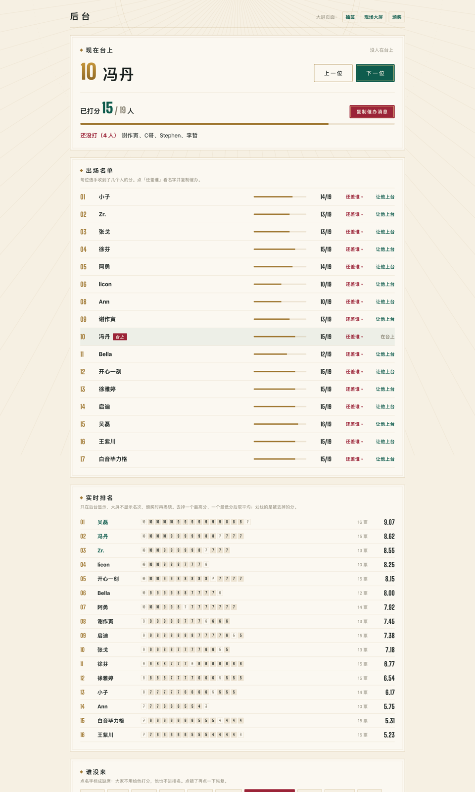
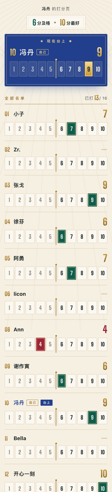
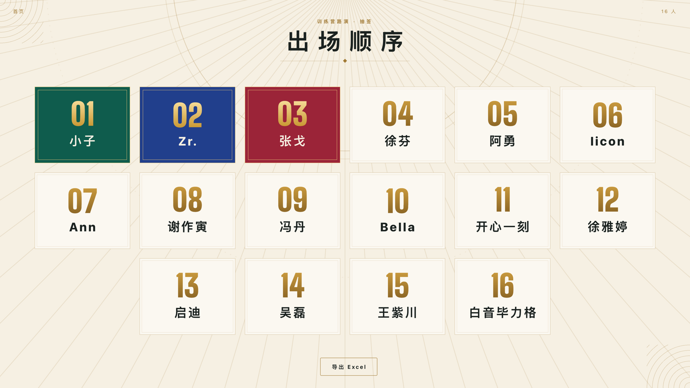
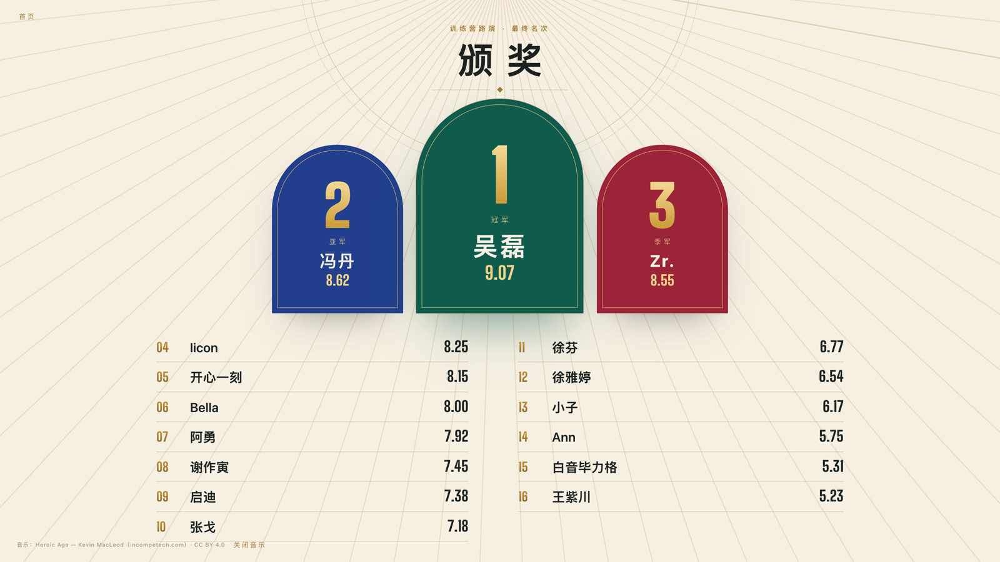

# 训练营路演打分系统

一个用于线下训练营路演的 H5 打分系统，覆盖 **抽签定出场顺序 → 评委扫码打分 → 现场大屏 → 后台催办 → 颁奖揭晓** 的完整流程。纯静态前端，数据存放在 WorkBuddy 云数据库，手机扫码即用（微信里也能直接打开），无需登录。

已在两场线下路演中实际使用：2026-10 杭州站（16 名学员上台、19 人打分）、2026-10 广州站（15 名学员上台、18 人打分）。各期部署情况与接手说明见 [docs/交接文档.md](docs/交接文档.md)。


## 目录

- [功能](#功能)
- [页面一览](#页面一览)
- [计分规则](#计分规则)
- [现场使用流程](#现场使用流程)
- [快速开始](#快速开始)
- [部署](#部署)
- [配置](#配置)
- [数据模型](#数据模型)
- [项目结构](#项目结构)
- [设计说明](#设计说明)
- [已知限制与安全](#已知限制与安全)
- [致谢与第三方资源](#致谢与第三方资源)

## 功能

- **抽签**：洗牌动画决定出场顺序，抽完自动锁定，防止被误点重抽；可导出 Excel。
- **一人一码打分**：每位评委一个专属二维码，打开即进入自己的打分页；1–10 分，随时可改。
- **跟随台上**：评委手机顶部固定显示「现在台上」的人，后台切换后几秒内自动跟随。
- **现场大屏**：只显示谁在台上、已有多少人打分、出场顺序，不显示分数和名次，保留颁奖悬念。
- **后台催办**：以台上的人为中心，直接列出还没给他打分的人，一键复制催办消息。
- **实时排名（仅后台）**：名次、每一票明细（被去掉的最高、最低分划线标出）。
- **缺席与工作人员**：缺席者一键移出打分和排名；工作人员只打分、不上台、不被打分。
- **颁奖揭晓**：点一下揭晓一个名次（季军 → 亚军 → 冠军），支持并列，带背景音乐与金纸动效。
- **防误操作**：公布名次后自动停止收分；抽签锁定；管理口令以 SHA-256 指纹校验。
- **彩排模式**：任意页面网址加 `?demo=1` 使用假分数预览，不读写真实分数。

## 页面一览

| 页面 | 文件 | 给谁用 | 说明 |
|---|---|---|---|
| 首页 | `index.html` | 组织者 | 四个入口 |
| 抽签 | `draw.html` | 大屏 | 洗牌动画、出场顺序、导出 Excel |
| 现场大屏 | `rank.html` | 大屏 | 台上是谁、打分进度、出场顺序 |
| 打分页 | `score.html?token=…` | 每位评委（手机） | 一人一码，跟随台上打分 |
| 后台 | `admin.html` | 组织者 | 切换台上、催办、实时排名、缺席、公布名次、二维码、导出 |
| 颁奖 | `final.html` | 大屏 | 公布名次后开放，逐个揭晓 |

<table>
  <tr>
    <td width="72%"></td>
    <td width="28%"></td>
  </tr>
  <tr>
    <td align="center">后台：现在台上、还没打分的人、出场名单、实时排名</td>
    <td align="center">评委打分页（手机）</td>
  </tr>
</table>

<table>
  <tr>
    <td></td>
    <td></td>
  </tr>
  <tr>
    <td align="center">抽签结果</td>
    <td align="center">颁奖揭晓</td>
  </tr>
</table>

## 计分规则

1. 每位评委给每位上台选手打 **1–10 分**（6 分及格，10 分最好），选手也给自己打分。
2. 某位选手收到 **3 票及以上** 时，去掉 1 个最高分和 1 个最低分，其余取平均；1–2 票时直接平均。
3. 平均分保留两位小数，**按两位小数比较，相同即并列**，名次采用 1、1、3 的方式。
4. 颁奖台按名次分组：并列的人站在同一座拱门里（例如「冠军（并列）」）；某个名次不存在时，对应拱门不出现。
5. 被标记为缺席的选手不进入排名；缺席者此前打出的分照常计入。
6. 后台公布名次后停止收分，撤回公布即可恢复打分。

## 现场使用流程

| 阶段 | 大屏电脑 | 后台电脑 | 评委 |
|---|---|---|---|
| 开场前 | 打开 `draw.html` 抽签 | 在「评委二维码」中下载或打印二维码分发；线上参会者点「复制链接」 | 扫自己的二维码，保存页面 |
| 路演中 | 打开 `rank.html` 现场大屏 | 点「下一位」切换台上的人；复制催办消息；有人缺席就在「谁没来」中标记 | 在「现在台上」卡片中打分 |
| 结束 | — | 确认都打完后点「公布名次」，导出 Excel | 打分自动关闭 |
| 颁奖 | 打开 `final.html`，每点一下揭晓一个名次 | — | — |

两台电脑可以同时使用：只有后台会修改数据，大屏只读并每 3–4 秒自动刷新。同一评委在多台设备上打开也没有问题，分数是同一条记录，几秒内互相同步。

## 快速开始

无需构建，任意静态服务器即可运行：

```bash
cd training-camp-scoring
python3 -m http.server 8765
```

然后打开 <http://localhost:8765/admin.html?demo=1> 进入彩排模式浏览全部功能。

> 彩排模式（`?demo=1`）使用固定的假分数，名单（缺席、工作人员）读取真实设置，不会写入任何数据。站内链接会自动保留该参数。

## 部署

网页发布在 GitHub Pages，数据库使用 WorkBuddy 云数据库（三张表，见[数据模型](#数据模型)，对匿名用户开放读写）。

WorkBuddy 托管的网页在微信内无法打开，而它的数据库只接受自家域名或「来源为空」的请求，所以发布产物采用「沙盒外壳」结构：原始页面放在 `app/`，外层同名页面（`pages/shell.js`）把它装进 sandbox iframe 运行。生成与发布：

```bash
bash pages/build.sh <输出目录>      # 生成发布文件（外壳 + app/）
```

把输出目录的内容提交到 `gh-pages` 分支即可上线。发布后逐个比对线上与本地文件；每次修改 `theme.css`、`cloud.js`、`deco.js`，要提升各页面中的 `?v=` 版本号，避免现场设备使用缓存的旧代码。详细步骤见 [docs/交接文档.md](docs/交接文档.md)。

也可以部署到任何静态托管平台，只需把 `cloud.js` 中的数据库连接换成你自己的后端（不再需要外壳）。

## 配置

所有配置都在 `cloud.js` 顶部：

| 配置 | 说明 |
|---|---|
| `endpoint` / `publishableKey` | WorkBuddy 云数据库地址与公开连接密钥 |
| `ADMIN_HASH` | 管理口令的 SHA-256 指纹 |

修改管理口令：

```bash
echo -n "新口令" | shasum -a 256
```

把输出的指纹填入 `ADMIN_HASH`，重新发布即可。

## 数据模型

| 表 | 字段 | 说明 |
|---|---|---|
| `participants` | `id`、`name`、`token`、`draw_order` | 名单。`token` 即二维码身份；`draw_order` 为出场顺序，工作人员为空 |
| `scores` | `judge_token`、`target_id`、`score`、`updated_at` | 打分记录，`(judge_token, target_id)` 唯一，改分即覆盖 |
| `settings` | `key`、`value` | 运行状态（见下表） |

`settings` 中使用的 key：

| key | 值 | 含义 |
|---|---|---|
| `draw_done` | `true` / `false` | 抽签是否已完成（完成即锁定） |
| `on_stage` | 选手 id | 现在台上的人 |
| `absent` | 逗号分隔的 id | 缺席名单 |
| `staff` | 逗号分隔的 id | 工作人员（只打分） |
| `finalized` | `true` / `false` | 是否已公布名次 |

## 项目结构

```
.
├── index.html          首页
├── draw.html           抽签
├── rank.html           现场大屏
├── score.html          评委打分页
├── admin.html          后台
├── final.html          颁奖
├── cloud.js            数据层：读写数据库、计分与排名、名单（选手/评委/缺席/工作人员）、口令校验
├── deco.js             装饰与动效：放射金线、数字滚动、金纸
├── theme.css           设计系统：配色、字体、按钮、拱门、双金线框
├── assets/             颁奖背景音乐及来源说明
├── fonts/              数字字体
├── vendor/             第三方库（本地化，不依赖 CDN）
├── pages/              GitHub Pages 发布：沙盒外壳 shell.js 与生成脚本 build.sh
├── docs/
│   ├── 交接文档.md      当前状态、部署方式、现场使用、规矩（接手先读）
│   ├── 需求文档.md      原始需求（第一期）
│   ├── archive/        过时的历史文档
│   └── screenshots/    README 截图
└── 评委二维码/
    ├── 杭州站/          第一期评委二维码
    └── 广州站/          第二期评委二维码
```

`.wbapp_*.genie` 和 `.workbuddy/` 是 WorkBuddy 的应用配置与工作记录，带「第一期」字样的是第一期应用的配置，保留备查。

## 设计说明

视觉方向为「巴黎装饰艺术」，参考 2024 巴黎奥运会视觉中的 1924 年 Art Deco 元素：象牙底色，墨绿、宝蓝、酒红三色宝石拱门，金线与金色数字。大屏统一使用浅色背景，以适应投影仪在明亮会场中的显示效果。

界面遵循「最少必要」原则：每个页面只显示当下需要的信息；大屏不显示分数，避免影响后续上台选手和评委；不使用 emoji，按钮与提示均为口语化中文。

## 已知限制与安全

- 没有账号体系，二维码即身份；获得他人链接即可替其打分。
- 管理口令在前端校验，只用于防止误入，不能抵御有意的攻击。
- 数据库对匿名用户开放读写。活动结束后，建议下线应用或关闭写入权限。
- 本仓库包含活动当时的名单、二维码与配置，仅作记录与参考。

## 致谢与第三方资源

| 资源 | 作者 | 许可 |
|---|---|---|
| 背景音乐 | 第二期由活动方提供，来源见 `assets/BGM来源.txt`；第一期为 Kevin MacLeod《Heroic Age》（[incompetech.com](https://incompetech.com)） | 第一期曲目为 [CC BY 4.0](https://creativecommons.org/licenses/by/4.0/) |
| 数字字体 Big Shoulders Display | Patric King / Fontsource | SIL Open Font License 1.1 |
| [qrcode-generator](https://github.com/kazuhikoarase/qrcode-generator) | Kazuhiko Arase | MIT |
| [SheetJS](https://sheetjs.com)（xlsx 0.18.5） | SheetJS LLC | Apache-2.0 |
| WorkBuddy Cloud SDK 0.1.3 | 腾讯 WorkBuddy | — |

本项目暂未附带开源许可证。
